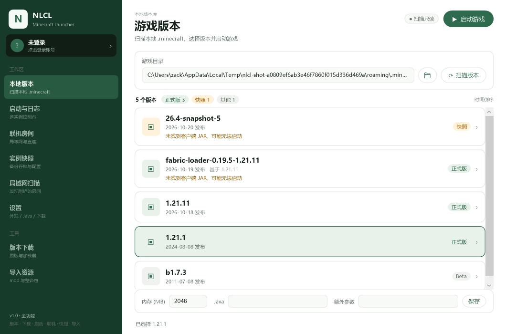

# NLMCL

Minecraft Java 版启动器。

- **前端**：WPF（XAML），自研。
- **后端**：PCL（Plain Craft Launcher）成熟实现，经适配层接入。
- **架构**：分层单体 + 端口/适配器 + MVVM。详见 [docs/ARCHITECTURE.md](docs/ARCHITECTURE.md)。

## 快速开始

```powershell
.\scripts\build.ps1     # 构建
.\scripts\test.ps1      # 测试
.\src\NLMCL.App\bin\Debug\net48\NLMCL.exe
```

要求：.NET SDK 8+（无需 Visual Studio）。首次构建会自动还原 NuGet 包。

## 解决方案结构

```
src/
  NLMCL.Abstractions      端口契约（netstandard2.0）——全项目的稳定边界
  NLMCL.Core              领域与编排（C# / net48）
  NLMCL.Core.Pcl          PCL 适配层（VB.NET / net48）——唯一允许出现 VB 的地方
  NLMCL.App.ViewModels    展示逻辑（C# / net48，零 WPF 依赖，可单测）
  NLMCL.App               WPF 视图 + 组合根（C# / net48）
tests/
  NLMCL.Tests             单元测试 + XAML 冒烟测试
legacy/                  旧的 Python + Flet 实现（迁移对照物，勿删）
```

依赖方向只能向下：`App → ViewModels → Core → Abstractions ← Core.Pcl`。

## 当前状态

**M1 完成**：分层骨架、契约、MVVM、DI、测试与可运行外壳。
**M2 完成**：版本扫描已接入 PCL 的 `McVersion`，能真实读取 `.minecraft/versions`。



上图由 `RenderSnapshotTests` **端到端**生成：造一个假 `.minecraft` → 用真实的 `PclVersionCatalog` 扫描 → 离屏渲染成 PNG。不需要桌面会话，CI 里也能出图。

下一步见 [docs/ARCHITECTURE.md](docs/ARCHITECTURE.md) 第 8 节里程碑；逐模块迁移去向见 [docs/MIGRATION-MAP.md](docs/MIGRATION-MAP.md)。

## 约定

工程约定见仓库根目录 `AGENTS.md`。改动架构前务必先读第 3 节。
